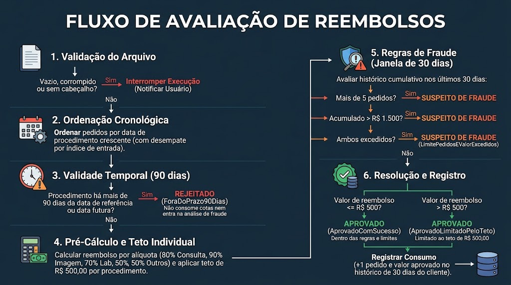

# Desafio Optino - Processamento de Reembolsos

O projeto foi desenvolvido para atender aos requisitos especificados no enunciado do desafio.

### Arquitetura da Solução

A solução é estruturada em:

* **Core & Application (.NET):** Regras de negócio e cálculos de reembolso totalmente desacoplados de infraestrutura e I/O.
* **CLI (.NET):** Processamento em lote com leitura via `stdin` e saída de resultados em `stdout`.
* **API REST (ASP.NET Core):** Endpoints para importação/exportação de CSV (`multipart/form-data`) e suporte a payloads JSON.
* **Testes (xUnit):** Cobertura unitária e de integração (utilizando FluentAssertions e WebApplicationFactory).
* **Frontend (React 19 + TypeScript):** Interface SPA construída com Vite e Vanilla CSS.
---

## 🏛️ Arquitetura e Decisões Técnicas

A solução foi estruturada seguindo os princípios de **Clean Architecture**, **SOLID** e **Clean Code**:

```
DesafioReembolso/
├── src/
│   ├── DesafioReembolso.Core/          # Domínio: Entidades, Enums, Regras de Negócio e Serviços de Domínio
│   │   ├── Enums/                    # TipoProcedimento, StatusPedido, MotivoStatus
│   │   ├── Models/                   # PedidoReembolso, PedidoProcessado, ClienteHistoricoLote
│   │   ├── Rules/                    # ICalculadoraReembolso, IRegraPrazo, IMotorPrevencaoFraude
│   │   └── Services/                 # IProcessadorLoteService, ProcessadorLoteService
│   │
│   ├── DesafioReembolso.Application/   # Aplicação: DTOs, Serviços de CSV e Injeção de Dependências
│   │   ├── DTOs/                     # PedidoInputDto, PedidoOutputDto, ProcessarLoteDto
│   │   └── Services/                 # ICsvService, CsvService (parse e geração tolerante a encoding/BOM)
│   │
│   ├── DesafioReembolso.Cli/           # Adaptador de Entrada/Saída: Console stdin/stdout
│   │   └── Program.cs
│   │
│   └── DesafioReembolso.Api/           # Adaptador Web: ASP.NET Core Web API com OpenAPI e CORS
│       ├── Controllers/              # ReembolsosController
│       └── Program.cs
│
├── frontend/                         # Interface Web em React + TypeScript (Vite + Vanilla CSS)
│   ├── src/
│   │   ├── types/                    # Tipos TypeScript compartilhados (reembolso.ts)
│   │   ├── App.tsx                   # Fluxo completo: seleção, envio, filtros, paginação e exportação
│   │   └── index.css                 # Design System moderno, responsivo e de alto contraste
│   └── package.json
│
├── tests/
│   └── DesafioReembolso.Tests/         # 54 Testes Unitários, de Integração e Benchmark
│       ├── CalculadoraReembolsoTests.cs
│       ├── RegraPrazo90DiasTests.cs
│       ├── MotorPrevencaoFraudeTests.cs
│       ├── ProcessadorLoteServiceTests.cs
│       ├── CsvServiceTests.cs
│       ├── TipoProcedimentoTests.cs
│       ├── ReembolsosApiTests.cs
│       ├── SimulacaoLoteBenchmarkTests.cs
│       └── CincoRegrasDeNegocioTests.cs
│
└── exemplos/
    ├── pedidos_exemplo.csv                     # Arquivo CSV de exemplo oficial (4 pedidos)
    ├── teste_regra1_aliquotas.csv              # Teste Regra 1: Alíquotas (80%, 90%, 70%, 50%)
    ├── teste_regra2_teto_500.csv               # Teste Regra 2: Limite máximo de R$ 500 por procedimento
    ├── teste_regra3_prazo_90dias.csv           # Teste Regra 3: Validade de 90 dias e datas futuras
    ├── teste_regra4_fraude_limite_pedidos.csv  # Teste Regra 4: Máximo de 5 pedidos em 30 dias
    ├── teste_regra5_fraude_teto_1500.csv       # Teste Regra 5: Teto de R$ 1.500 em 30 dias
    └── pedidos_10000.csv                       # Amostra de simulação com 10.000 pedidos
```

### Justificativa de Bibliotecas e Frameworks Utilizados

- **.NET (C#) e ASP.NET Core:** Escolhido por seu desempenho nativo, tipagem estática robusta, excelente ecossistema para APIs de alta confiabilidade e suporte cross-platform.
- **FluentAssertions (Testes):** Facilita a leitura e manutenibilidade dos testes com assertivas expressivas e relatórios claros de falhas.
- **Microsoft.AspNetCore.Mvc.Testing (Testes de Integração):** Permite simular o pipeline HTTP completo da API em memória, sem depender de portas de rede abertas.
- **System.Text.Json e System.Globalization (Nativos):** Sem dependência de bibliotecas de terceiros desnecessárias para JSON ou CSV, mantendo o backend enxuto e seguro.
- **React 19 com TypeScript e Vite (Frontend):** Alta produtividade, tipagem estática de ponta a ponta e inicialização em milissegundos.
- **Vanilla CSS (Sem bibliotecas visuais externas):** Atendendo à diretriz de evitar dependências desnecessárias, todo o design system (glassmorphism, responsividade móvel/desktop, estados de erro/loading e tokens de acessibilidade) foi construído em CSS puro, sem sobrecarga de Tailwind, Bootstrap ou UI kits de terceiros.
- **Web APIs Nativas (Fetch, FormData, Blob, URL):** Comunicação HTTP com a API e geração/download instantâneo de CSV sem necessidade de bibliotecas adicionais como Axios ou FileSaver.

---

## ⚖️ Decisões sobre Conflitos entre Regras e Valores Exibidos

Conforme exigido na especificação, detalhei as decisões de design adotadas para a resolução de conflitos e exibição de valores:

### 1. Ordem de Avaliação das Regras
Para garantir que as regras sejam aplicadas de maneira determinística, segura e justa:


1. **Validação do Arquivo de Entrada:** Verifica a integridade do arquivo recebido. Se o arquivo estiver vazio, sem cabeçalho válido ou com linhas ausentes/corrompidas, a execução é interrompida com notificação clara ao usuário.
2. **Ordenação Cronológica:** Os pedidos são ordenados internamente por `DataProcedimento` crescente (e índice de entrada para desempate). Isso garante que os procedimentos realizados primeiro tenham preferência de consumo das cotas.
3. **Regra de Validade Temporal (90 dias):**
   - Se o procedimento ocorreu há mais de 90 dias em relação à data de referência (ou possui data futura), o pedido é marcado como **`Rejeitado`** com motivo `ForaDoPrazo90Dias`.
   - **Conflito resolvido:** Pedidos com prazo expirado são rejeitados de imediato e **não** são submetidos à análise de fraude, nem consomem as cotas de quantidade (5) ou valor (R$ 1.500) do cliente na janela de 30 dias.
4. **Pré-Cálculo de Reembolso e Teto Individual:**
   - Calcula o valor percentual com base na alíquota (`80%` Consulta Médica, `90%` Exame de Imagem, `70%` Exame Laboratorial, `50%` Outros).
   - Aplica o teto de **R$ 500,00** por procedimento e verifica se o valor calculado excedeu o teto.
5. **Regras de Fraude (Janela de 30 dias):**
   - Procedimentos realizados na janela dos últimos 30 dias (`[dataReferencia - 30 dias, dataReferencia]`) são avaliados cumulativamente:
     - **Limite de Pedidos:** Máximo de 5 pedidos aprovados na janela. O 6º pedido em diante é marcado como **`Suspeito de Fraude`**.
     - **Limite de Valor:** Total reembolsado acumulado não pode ultrapassar R$ 1.500,00. Qualquer pedido cujo valor de reembolso faça o total exceder R$ 1.500 é marcado como **`Suspeito de Fraude`**.
     - **Ambos os limites excedidos:** Marcado como **`Suspeito de Fraude`** com motivo `LimitePedidosEValorExcedidos`.
6. **Aprovação e Registro de Consumo:**
   - Se aprovado integralmente ($\le$ R$ 500): motivo `AprovadoComSucesso` (*"Pedido aprovado dentro das regras e limites vigentes."*).
   - Se aprovado com valor limitado pelo teto (> R$ 500): motivo `AprovadoLimitadoPeloTeto` (*"Pedido aprovado com valor limitado ao teto máximo de R$ 500,00 por procedimento."*).
   - Registra o consumo de cota (+1 pedido e valor aprovado) no histórico de 30 dias do cliente.

### 2. Ordenação Determinística do Lote
Em um lote com múltiplos pedidos do mesmo cliente, a ordem de processamento define quem consome as cotas antes de estourar os limites. O motor processa os pedidos internamente por **ordem cronológica** (`DataProcedimento` crescente) e desempate pelo `Id`/ordem de inserção. Isso garante que os procedimentos que ocorreram primeiro recebam a aprovação legítima.
Após o cálculo, o resultado é **reordenado para a ordem original de entrada do CSV**, garantindo que a resposta devolvida ao usuário corresponda exatamente à sequência do arquivo importado.

### 3. Valor Exibido para Pedidos Rejeitados ou Suspeitos
No exemplo oficial do enunciado:
```csv
Id,TipoProcedimento,DataProcedimento,ValorPago,ValorReembolsado,ClienteId,Status
4,Outros,2024-01-20,150,75,126,Rejeitado
```
Observa-se que o campo `ValorReembolsado` exibe **75** (isto é, `150 * 50%`), enquanto o status é marcado como `Rejeitado`.
Adotamos essa mesma diretriz consistente:
- **`ValorReembolsado`**: Reflete o valor calculado que teria direito pelas regras de alíquota e teto de R$ 500. Isso é fundamental para fins de **auditoria, rastreabilidade e transparência** (o usuário e o analista conseguem ver quanto foi pleiteado).
- **Impacto no Saldo/Cota:** Pedidos marcados como `Rejeitado` ou `Suspeito de Fraude` **NÃO** somam no total reembolsado efetivo da API e **NÃO** bloqueiam futuros reembolsos válidos de outros pedidos.

### 4. Auditoria e Logs Estruturados para Pedidos Rejeitados ou Suspeitos
Para garantir total rastreabilidade, compliance e auditoria analítica:
- **Na API HTTP (ASP.NET Core):** O `ReembolsosController` utiliza `ILogger` estruturado com severidade `Warning` para registrar cada ocorrência com `PedidoId`, `ClienteId`, `TipoProcedimento`, `DataProcedimento`, valores e o motivo detalhado da rejeição/retenção preventiva por suspeita de fraude, finalizando com um resumo informativo (`LogLevel.Information`) do lote.
- **Na CLI (.NET):** Os registros de auditoria são direcionados para o fluxo de erro padrão (`stderr`). Isso garante que o `stdout` permaneça estritamente formatado com o CSV limpo para encadeamento em pipes e scripts (ex: `Get-Content pedidos.csv | dotnet run > resultado.csv`).

---

## 🚀 Como Compilar e Executar

### Pré-requisitos
- .NET SDK 8.0 ou superior (instalado e disponível no PATH).

### Compilar a Solução
```bash
dotnet build DesafioReembolso.slnx
```

---

## 💻 Executando a CLI

A aplicação CLI lê o CSV de `stdin` e cospe o CSV resultante em `stdout`.

```bash
# Executando no PowerShell com data de referência padrão (2024-05-10)
Get-Content exemplos/pedidos_exemplo.csv | dotnet run --project src/DesafioReembolso.Cli

# Especificando uma data de referência customizada
Get-Content exemplos/pedidos_exemplo.csv | dotnet run --project src/DesafioReembolso.Cli -- -d 2024-05-10

# Redirecionando a saída para um novo arquivo CSV
Get-Content exemplos/pedidos_exemplo.csv | dotnet run --project src/DesafioReembolso.Cli -- -d 2024-05-10 > resultado.csv
```

---

## 🌐 Executando a API HTTP

### Iniciar o servidor
```bash
dotnet run --project src/DesafioReembolso.Api
```

- **URL Padrão:** `http://localhost:5244`
- **Documentação OpenAPI:** `http://localhost:5244/openapi/v1.json`
- **CORS:** Liberado para requisições de origens locais (ex: `http://localhost:5173`, `http://localhost:3000`).

### Exemplos de Chamada à API

#### 1. Processar arquivo CSV via `multipart/form-data`:
```bash
curl -X POST "http://localhost:5244/api/reembolsos/processar-csv" \
  -F "arquivo=@exemplos/pedidos_exemplo.csv" \
  -F "dataReferencia=2024-05-10"
```

**Resposta JSON:**
```json
{
  "dataReferencia": "2024-05-10",
  "totalProcessados": 4,
  "totalAprovados": 3,
  "totalRejeitados": 1,
  "totalSuspeitos": 0,
  "valorTotalReembolsadoAprovado": 960.00,
  "pedidos": [
    {
      "id": 1,
      "tipoProcedimento": "Consulta Médica",
      "dataProcedimento": "2024-02-10",
      "valorPago": 400,
      "valorReembolsado": 320.00,
      "clienteId": "123",
      "status": "Aprovado",
      "motivo": "Pedido aprovado dentro das regras e limites vigentes."
    },
    {
      "id": 2,
      "tipoProcedimento": "Exame de Imagem",
      "dataProcedimento": "2024-03-01",
      "valorPago": 600,
      "valorReembolsado": 500.00,
      "clienteId": "124",
      "status": "Aprovado",
      "motivo": "Pedido aprovado com valor limitado ao teto máximo de R$ 500,00 por procedimento."
    },
    {
      "id": 3,
      "tipoProcedimento": "Exame Laboratorial",
      "dataProcedimento": "2024-04-15",
      "valorPago": 200,
      "valorReembolsado": 140.00,
      "clienteId": "125",
      "status": "Aprovado",
      "motivo": "Pedido aprovado dentro das regras e limites vigentes."
    },
    {
      "id": 4,
      "tipoProcedimento": "Outros",
      "dataProcedimento": "2024-01-20",
      "valorPago": 150,
      "valorReembolsado": 75.00,
      "clienteId": "126",
      "status": "Rejeitado",
      "motivo": "Pedido rejeitado: data do procedimento fora do limite de 90 dias em relação à data de referência."
    }
  ]
}
```

#### 2. Processar lote via JSON:
```bash
curl -X POST "http://localhost:5244/api/reembolsos/processar-lote" \
  -H "Content-Type: application/json" \
  -d '{
    "dataReferencia": "2024-05-10",
    "pedidos": [
      {
        "id": 1,
        "tipoProcedimento": "Consulta Médica",
        "dataProcedimento": "2024-02-10",
        "valorPago": 400,
        "clienteId": "123"
      }
    ]
  }'
```

---

## 💻 Executando o Frontend (React + TypeScript)

A interface web foi desenvolvida em **React 19** com **TypeScript** e **Vite**, sem dependência de bibliotecas de componentes externas pesadas.

### Pré-requisitos
- Node.js 18+ e npm instalados.

### Iniciar o Frontend em Modo de Desenvolvimento
```bash
# 1. Navegar até a pasta do frontend
cd frontend

# 2. Instalar dependências (apenas na primeira vez)
npm install

# 3. Iniciar o servidor de desenvolvimento
npm run dev
```

- **URL da Aplicação Web:** `http://localhost:5173`
- **Comunicação com a API:** O Vite está configurado para direcionar chamadas `/api/*` via proxy para `http://localhost:5244`. Além disso, a API possui política de CORS configurada caso seja acessada diretamente.

### Recursos e Fluxo da Interface:
1. **Seleção de Arquivo e Data:**
   - Dropzone interativa para selecionar ou arrastar o arquivo `.csv`.
   - Campo para informar a data de referência (padrão predefinido: `2024-05-10`).
2. **Envio Protegido:**
   - O botão **"Processar Lote"** desabilita automaticamente durante a requisição, exibindo um *spinner* de carregamento e evitando envios duplicados.
3. **Métricas e Cards de Resumo:**
   - Cards com contagem de Total Processados, Aprovados (com valor total em R$), Rejeitados e Suspeitos de Fraude.
4. **Tabela Acessível e Detalhada:**
   - Exibe `Id`, `Tipo de Procedimento` (com o motivo detalhado), `Data`, `Valor Pago`, `Valor Reembolsado`, `ID Cliente` e `Status`.
   - **Acessibilidade de Status:** Todos os status são diferenciados expressamente por **texto e ícones** (`✓ Aprovado`, `✕ Rejeitado`, `⚠️ Suspeito de Fraude`), sem depender exclusivamente de cor.
5. **Filtro de Visualização:**
   - Filtro por pílulas: `Todos`, `Aprovado`, `Rejeitado` e `Suspeito de Fraude`.
6. **Download do CSV Completo:**
   - O botão **"Baixar CSV Completo"** gera o arquivo no formato e cabeçalho oficiais (`Id,TipoProcedimento,DataProcedimento,ValorPago,ValorReembolsado,ClienteId,Status`), garantindo que **todos** os pedidos do lote sejam preservados no arquivo baixado, mesmo que a tabela na tela esteja filtrada.
7. **Tratamento de Estados e Erros:**
   - Estados de: inicial, carregando, sem resultados e erro detalhado (arquivo corrompido, campos ausentes ou API indisponível) com botão para tentar novamente sem necessidade de recarregar a página.
8. **Paginação Eficiente:**
   - Paginação fluida para suportar lotes massivos (como o teste de 10.000 pedidos) com alta performance no navegador.

---

## 🧪 Executando os Testes Automatizados

A suíte possui **48 testes unitários e de integração** cobrindo todas as regras de negócio, limites e contratos:

```bash
dotnet test tests/DesafioReembolso.Tests/DesafioReembolso.Tests.csproj
```

**Principais áreas testadas:**
- Alíquotas e teto de R$ 500 por tipo de procedimento (`CalculadoraReembolsoTests.cs`).
- Limites de 90 dias e tratamento de datas futuras (`RegraPrazo90DiasTests.cs`).
- Regras de fraude de 5 pedidos e teto de R$ 1.500 em 30 dias (`MotorPrevencaoFraudeTests.cs`).
- Casos de conflito e ordenação determinística (`ProcessadorLoteServiceTests.cs`).
- Tratamento de CSV com BOM, variações de acentuação e formatos de data (`CsvServiceTests.cs`).
- Integração ponta a ponta da API via `WebApplicationFactory` (`ReembolsosApiTests.cs`).
- Simulação de throughput e auditoria de lote massivo com 10.000 pedidos (`SimulacaoLoteBenchmarkTests.cs`).

## 💡 Notas Adicionais Relevantes e Desafios de Negócio

Durante o desenvolvimento e análise dos requisitos, foram identificados cenários de fronteira  que envolvem regras de negócio, experiência do cliente e segurança operacional:

---

### 1. Teto de R$ 500,00 por Procedimento vs. Experiência do Cliente (SAC)

* **O Cenário:**  
  Imagine uma consulta médica no valor de **R$ 1.000,00**. Pela regra de alíquota (80%), o reembolso calculado seria de **R$ 800,00**. No entanto, devido à regra do teto máximo de **R$ 500,00 por procedimento**, cortamos o valor excedente (R$ 300,00) e liberamos R$ 500,00.

* **O Dilema de Negócio:**  
  Pela especificação estrita do desafio, esse pedido recebe o status final de **`Aprovado`** com o valor de R$ 500,00. Contudo, sob a ótica de produto e suporte ao cliente:
  * O segurado que pagou R$ 1.000,00 e conhece a porcentagem de 80% espera receber R$ 800,00.
  * Ao ver o status simplesmente como "Aprovado" recebendo R$ 500,00 sem uma justificativa explícita no comprovante simples, a percepção inicial do cliente é de que **houve um erro de cálculo**.
  * Isso tende a gerar um volume significativo de novos chamados.

* **Como Decidimos Fazer:**
  1. **Conformidade com o Contrato do Desafio:** No arquivo CSV gerado (saída padrão do batch e da CLI), mantivemos estritamente os status exigidos pela especificação (`Aprovado`, `Rejeitado`, `Suspeito de Fraude`), garantindo 100% de compatibilidade com pipelines e testes automatizados de avaliação.
  2. **Transparência no Domínio e Logs de Auditoria:** Criamos no domínio interno o motivo detalhado `MotivoStatus.AprovadoLimitadoPeloTeto` e a flag `AtingiuTetoMaximo`. Esses dados são expostos na API HTTP e no Frontend, permitindo ao operador do sistema identificar imediatamente que o corte ocorreu por aplicação do teto de R$ 500,00.
  3. **Sugestão de Evolução de Produto:** Em um cenário de produção real, a recomendação arquitetural é adotar um status intermediário como **`Aprovado Parcialmente`** ou adicionar uma coluna obrigatória de `Observacao`/`Motivo` no extrato do beneficiário para sanar dúvidas proativamente e evitar gargalos.

---

### 2. Extrapolação do Limite Antifraude de R$ 1.500,00 em 30 Dias

* **O Cenário:**  
  Um cliente já possui **R$ 1.400,00** em reembolsos aprovados nos últimos 30 dias. Ele envia um novo pedido cujo valor de reembolso elegível é de **R$ 200,00**. Somando ao histórico recente, o total acumulado atingiria **R$ 1.600,00**, extrapolando o teto de R$ 1.500,00.

* **O Dilema de Negócio:**  
  O que fazer com esse novo pedido?
  * *Opção A (Fatiamento):* Reembolsar parcialmente R$ 100,00 (atingindo exatamente os R$ 1.500,00 permitidos) e rejeitar/marcar como suspeito apenas os R$ 100,00 restantes?
  * *Opção B (Atomicidade e Bloqueio Integral):* Marcar o pedido inteiro de R$ 200,00 como `Suspeito de Fraude`?

* **Como Decidimos Fazer:**
  1. **Princípio de Atomicidade e Mitigação de Risco:** Adotamos a **Opção B**. Em conformidade com a diretriz do enunciado (*"Os pedidos que ultrapassarem esse limite devem ser marcados como 'Suspeito de Fraude'"*) e com as melhores práticas de auditoria e compliance em saúde suplementar, uma transação que aciona gatilho de risco **não deve ser fracionada para aprovação parcial**.
  2. **Segurança Operacional:** Dividir a transação violaria o propósito do motor de risco. Portanto, o pedido que provoca a extrapolação do teto é marcado integralmente como **`Suspeito de Fraude`** com valor reembolsado de R$ 0,00 efetivo para pagamento, sendo retido para conferência em mesa de auditoria humana.
  3. **Preservação de Histórico:** Os pedidos anteriores legítimos (R$ 1.400,00) permanecem aprovados e não são alterados retroativamente, preservando o direito adquirido e a rastreabilidade cronológica dos eventos.

---

## 🤝 Considerações Finais & Contato

Agradeço imensamente a oportunidade de desenvolver este projeto! Foi uma excelente experiência desenhar tanto o núcleo de processamento em lote quanto as integrações via CLI, API e interface web.

Estou à total disposição para quaisquer esclarecimentos, dúvidas ou informações adicionais.

* **Candidato:** Matheus Veker Camatta
* **E-mail:** [matheusvekerc@gmail.com](mailto:matheusvekerc@gmail.com)
* **Telefone / WhatsApp:** [(27) 99587-5682](tel:+5527995875682)
